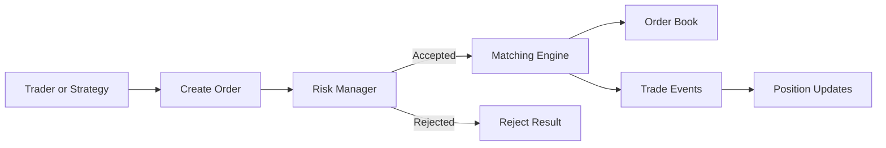
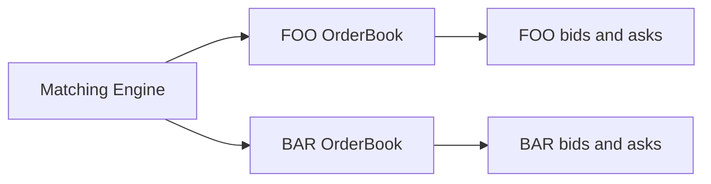
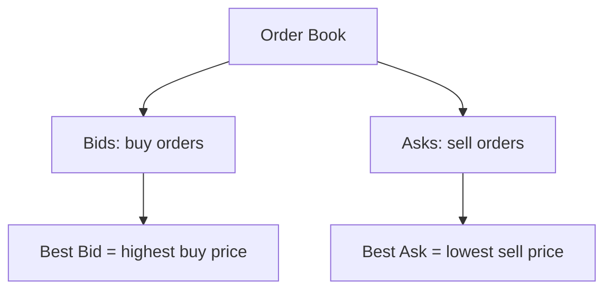
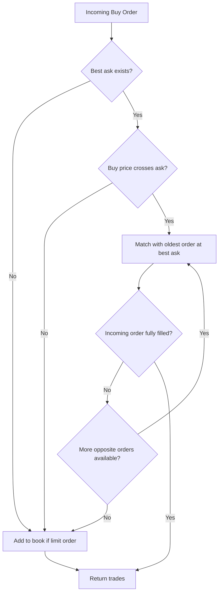
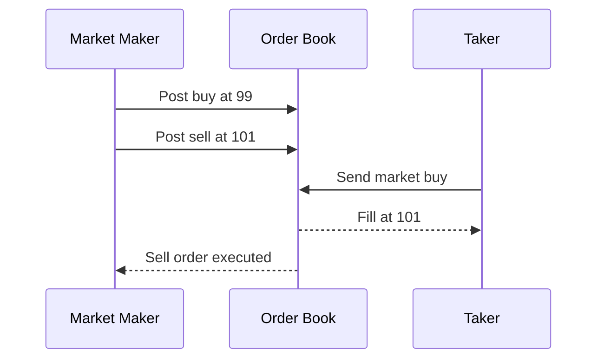

# Trading Simulator Architecture Flow

This page shows the simulator flow in small diagrams so you can connect the trading concepts to the code.

## 1) High-Level Request Flow

Meaning:

- A trader or strategy sends an order.
- The matching engine validates the order and selects the book for its symbol.
- Risk checks run before matching.
- If accepted, the matching engine tries to trade it.
- If it does not fully trade, remaining limit quantity can rest in the order book.
- Market orders never rest when liquidity is unavailable.
- Any executed trade updates positions for both owners.

## 2) Symbol-to-Book Mapping

The matching engine maintains one `OrderBook` per symbol:

Orders only match with orders for the same symbol. Positions are also tracked
per owner and symbol.

## 3) Order Book Structure

Meaning:

- `Bids` are people willing to buy.
- `Asks` are people willing to sell.
- The best bid is the highest buy price.
- The best ask is the lowest sell price.

## 4) Matching Flow For An Incoming Buy

Meaning:

- A buy order only trades against sell orders.
- It starts at the best ask.
- If the buy order is aggressive enough, it consumes liquidity.
- If it still has quantity left and it is a limit order, it rests in the book.

## 5) Market Maker vs Taker

Meaning:

- The market maker places resting quotes.
- The taker wants immediate execution.
- The taker trades at the current best available price.
- The maker earns the spread only if it can buy lower and sell higher over time.

## 6) Order Lifecycle Operations

Resting limit orders can be cancelled or modified. Cancellation marks the
order as `CANCELLED` and removes its remaining quantity from the book.
Modification acts as cancel/replace: it changes the remaining quantity, may
reduce but not increase it, and reinserts the order with new time priority.
Filled and cancelled orders cannot be modified. A partially filled order may
be modified or cancelled, but executed quantity is never restored. Ownership
checks prevent another participant from changing the order.

## 7) Code Mapping

- Order creation and demo flow: `src/main/java/com/lowlatencylab/sim/Main.java`
- Risk checks: `src/main/java/com/lowlatencylab/sim/risk/RiskManager.java`
- Matching logic and symbol routing: `src/main/java/com/lowlatencylab/sim/engine/MatchingEngine.java`
- Per-symbol book state: `src/main/java/com/lowlatencylab/sim/book/OrderBook.java`
- Trade records: `src/main/java/com/lowlatencylab/sim/model/Trade.java`
- Submission outcomes: `src/main/java/com/lowlatencylab/sim/engine/SubmissionResult.java`
- Latency recording: `src/main/java/com/lowlatencylab/sim/engine/LatencyRecorder.java`
- Market-maker quotes: `src/main/java/com/lowlatencylab/sim/strategy/NaiveMarketMakerStrategy.java`
- Automated behavior tests: `src/test/java/com/lowlatencylab/sim/engine/MatchingEngineTest.java`